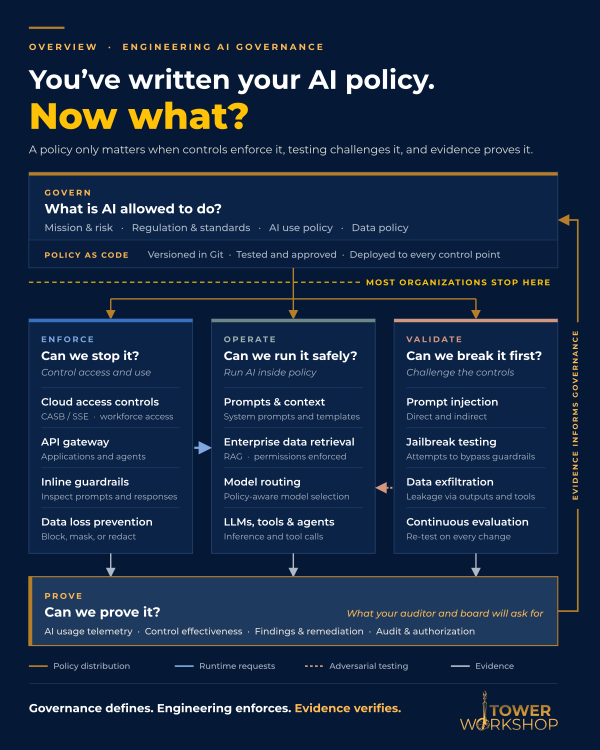
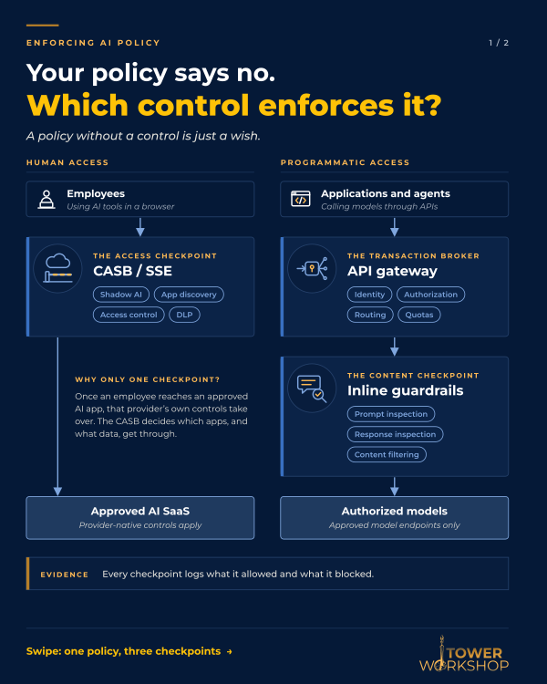
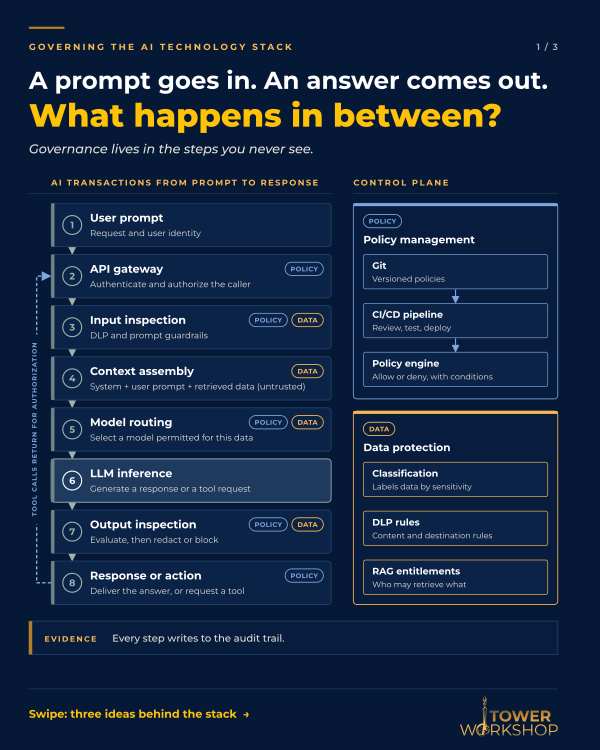

# Study Visuals

Infographics I make while studying technology, governance, and leadership topics. I use them for note-taking and as memory aids, and I share them on LinkedIn. This repository keeps them in one place, organized by topic and paired with written notes you can search.

Every infographic has a **companion note** (`.md`) that includes a short summary, the key takeaways, alt text, sources, and a link to the original LinkedIn post. Search engines can't read text inside an image, but they can read the notes.

---

## Topics

### 1. Engineering AI Governance: From Policy to Proof

> Effective AI governance is more than a set of policies, committees, and risk registers. It is an **engineered capability**: it turns organizational intent into technical controls, checks that those controls work, and produces evidence that they are effective.

This four-part series follows that path from intent to proof:

| # | Infographic | The question it answers | Status |
|---|-------------|-------------------------|--------|
| 00 | [**Engineering AI Governance: Overview**](topics/engineering-ai-governance/00-engineering-ai-governance.md) | You've written your AI policy. Now what? How do governance, enforcement, operations, testing, and evidence fit together? | Nov 2026 |
| 01 | [**Enforcing AI Policy**](topics/engineering-ai-governance/01-enforcing-ai-policy.md) | Your policy says no. Which control enforces it? Where do CASBs, API gateways, and inline guardrails sit, and what does each one stop? | Nov 2026 |
| 02 | [**Governing the AI Technology Stack**](topics/engineering-ai-governance/02-governing-the-ai-technology-stack.md) | A prompt goes in, an answer comes out: what happens in between? How do prompts, RAG, model routing, and policy as code work together under governance? | Nov 2026 |
| 03 | **Testing and Proving AI Security** | How do adversarial testing, data exfiltration testing, telemetry, and continuous evaluation show that the controls work? | Planned |

<p>
  <a href="topics/engineering-ai-governance/00-engineering-ai-governance.md"></a>
  <a href="topics/engineering-ai-governance/01-enforcing-ai-policy.md"></a>
  <a href="topics/engineering-ai-governance/02-governing-the-ai-technology-stack.md"></a>
</p>

📁 [`topics/engineering-ai-governance/`](topics/engineering-ai-governance/)

<!--
When an infographic is published, replace its row with a linked title and set Status to the publish date, e.g.:
| 03 | [**Testing and Proving AI Security**](topics/engineering-ai-governance/03-testing-and-proving-ai-security.md) | ... | Dec 2026 |
and add its thumbnail (thumbnails/engineering-ai-governance-03.png) to the gallery above.
-->

---

## Repository layout

```
study-visuals/
├── README.md                  # this index
├── LICENSE                    # CC BY 4.0
├── templates/
│   └── companion-note.md      # copy this for each new infographic
├── thumbnails/                # small (~600px wide) previews for the index
│   └── engineering-ai-governance-00.png
└── topics/
    └── engineering-ai-governance/
        ├── README.md          # topic overview
        ├── 00-engineering-ai-governance.png      # view on GitHub
        ├── 00-engineering-ai-governance@2x.png   # LinkedIn / presentations
        ├── 00-engineering-ai-governance.svg      # source graphic
        ├── 00-engineering-ai-governance-light.png / .svg
        ├── 00-engineering-ai-governance.pdf      # print
        ├── 00-engineering-ai-governance.md       # companion note
        └── source/            # build script and logos
```

**File naming:** `NN-short-kebab-title` with the same base name for the image, the PDF, and the companion note.

## Adding a new infographic

1. Export the visual as a PNG (for viewing on GitHub) and, if you like, a PDF (for printing).
2. Put both files in the right `topics/<topic>/` folder, named with the convention above.
3. Copy [`templates/companion-note.md`](templates/companion-note.md) to the same folder, give it the same base name, and fill it in.
4. Add a smaller thumbnail to `thumbnails/` and update the topic table above.
5. Once the LinkedIn post is live, add its link to the companion note, and add the note's link to the post.

## Reuse and attribution

You may share and adapt these infographics for any purpose, including commercial use, under the [Creative Commons Attribution 4.0 International License](LICENSE) (CC BY 4.0). All you need to do is give credit. Suggested attribution:

> "[Infographic title]" by Tower Workshop LLC, from [github.com/TheTowerworkshop/study-visuals](https://github.com/TheTowerworkshop/study-visuals), licensed under [CC BY 4.0](https://creativecommons.org/licenses/by/4.0/).

The infographics summarize and interpret publicly available frameworks, standards, and publications. Each companion note lists its sources. Third-party names, standards, and trademarks belong to their owners and are not covered by this license.

These visuals are study aids. They are not legal, compliance, or professional advice.

## Corrections and suggestions

If you spot an error, an outdated reference, or something that could be clearer, please [open an issue](https://github.com/TheTowerworkshop/study-visuals/issues). Corrections are welcome.

## Connect

- LinkedIn: [linkedin.com/in/rambertotorruella](https://www.linkedin.com/in/rambertotorruella/)
- Tower Workshop: [towerworkshop.com](https://www.towerworkshop.com/)

---

© 2026 Tower Workshop LLC. Licensed under [CC BY 4.0](LICENSE).
