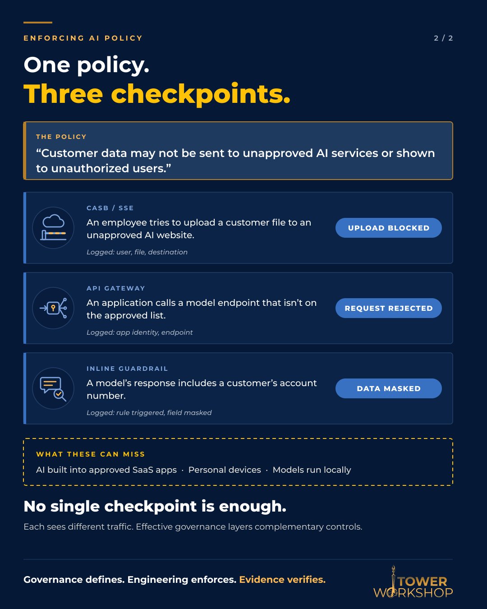

# Enforcing AI Policy

*Part 01 of the series [Engineering AI Governance: From Policy to Proof](README.md) · Zooms in on the Enforce column of the [overview](00-engineering-ai-governance.md)*

> **Your policy says no. Which control enforces it?**
>
> *A policy without a control is just a wish.*

This infographic is a two-page carousel.




📄 [Carousel PDF](01-enforcing-ai-policy.pdf) · 🖨️ [Light print PDF](01-enforcing-ai-policy-light.pdf) · 🖼️ Light version: [page 1](01-enforcing-ai-policy-light-p1.png), [page 2](01-enforcing-ai-policy-light-p2.png) · 🔍 High-resolution PNGs: [page 1](01-enforcing-ai-policy-p1@2x.png), [page 2](01-enforcing-ai-policy-p2@2x.png) · 💬 Discussion on LinkedIn (link coming soon)

## Summary

An AI policy can be enforced at three different checkpoints, and each one sees different traffic. A CASB controls which AI apps employees can reach and what data they can send. An API gateway controls which applications and agents can call which models. Inline guardrails inspect the content of prompts and responses. No single checkpoint provides complete coverage; effective governance layers all three.

## Key takeaways

- **There are two paths to AI, and they need different controls.** Employees use AI apps in a browser; applications and agents call models through APIs.
- **The paths are not symmetrical.** Once an employee reaches an approved AI app, that provider's own controls take over. Inline guardrails sit around the models your organization calls directly.
- **Each checkpoint answers a different question.** The CASB asks *which app and what data?* The gateway asks *which caller and which model?* The guardrail asks *what is in this prompt or response?*
- **One policy needs several enforcement points.** The same rule about customer data shows up as a blocked upload, a rejected API call, and a masked response.
- **Every checkpoint is also an evidence source.** What each one allowed and blocked is the raw material for proving the controls work (covered in 03).

## How to read the visual

**Page 1: the two journeys**

1. **Human access (left):** an employee using an AI tool in a browser passes through the **CASB / SSE**, *the access checkpoint*. It discovers shadow AI, controls which apps are allowed, and inspects uploads with data loss prevention (DLP). The employee then reaches an **approved AI SaaS** app, where the provider's own controls apply.
2. **Programmatic access (right):** an application or agent calls a model through the **API gateway**, *the transaction broker*. It checks identity, evaluates authorization, routes the request, and applies quotas. **Inline guardrails**, *the content checkpoint*, inspect prompts going in and responses coming out and filter prohibited content. Only then does the request reach an **authorized model**.
3. **Evidence (bottom):** every checkpoint logs what it allowed and what it blocked.

**Page 2: one policy, three checkpoints**

The policy: *"Customer data may not be sent to unapproved AI services or shown to unauthorized users."*

| Checkpoint | What happens | Outcome | What gets logged |
|------------|--------------|---------|------------------|
| CASB / SSE | An employee tries to upload a customer file to an unapproved AI website. | Upload blocked | User, file, destination |
| API gateway | An application calls a model endpoint that isn't on the approved list. | Request rejected | App identity, endpoint |
| Inline guardrail | A model's response includes a customer's account number. | Data masked | Rule triggered, field masked |

**What these can miss:** AI features built into approved SaaS apps, personal and unmanaged devices, and models run locally on a laptop or server. Coverage of each depends on how the controls are deployed.

## Why it matters

Most organizations deploy one of these controls and assume the policy is covered. A CASB alone can't see an internal application calling a model. A gateway alone can't stop an employee from pasting data into a public chatbot. Guardrails alone don't know whether the caller was allowed in the first place. Mapping each policy to the checkpoints that enforce it, and to the gaps none of them cover, is how a written policy becomes a defensible one.

Questions to ask your team:

1. For our most important AI policy, which checkpoint enforces it, on which path?
2. Do we know which AI apps employees use today, including the ones we never approved?
3. Can any application or agent call a model without going through a gateway?
4. Where do we inspect prompts and responses, and what happens when something is caught?
5. Which AI use falls into the gaps: embedded SaaS features, personal devices, local models?

## Key terms

| Term | Definition |
|------|------------|
| **CASB** (Cloud Access Security Broker) | Sits between employees and cloud services to see and control which apps people use and what data they send. |
| **SSE** (Security Service Edge) | A cloud-delivered platform that combines CASB with secure web access and zero-trust access controls. |
| **Shadow AI** | AI tools employees use without approval from IT or security. |
| **DLP** (Data Loss Prevention) | Detects sensitive data and stops it from leaving the organization. |
| **API gateway** | A controlled entry point for applications and agents calling AI models. Handles identity, authorization, routing, and quotas. |
| **Quota** | A limit on how many requests or how much usage a caller is allowed. |
| **Inline guardrails** | Checks that inspect prompts and responses as they pass and block, mask, or filter content that violates policy. |
| **Model endpoint** | The specific address an application calls to use a particular AI model. |

## Representative products

> **Note:** These are examples to help readers recognize each category. They are not endorsements or recommendations. Tower Workshop is vendor-neutral and does not resell products. Many vendors offer comparable capabilities, and the right choice depends on each organization's environment.

| Checkpoint | Examples |
|------------|----------|
| CASB / SSE | Netskope, Microsoft Defender for Cloud Apps, Zscaler, Palo Alto Networks Prisma Access |
| API gateway | Azure API Management, Kong, Amazon API Gateway, Google Apigee |
| Inline guardrails | Amazon Bedrock Guardrails, Azure AI Content Safety, NVIDIA NeMo Guardrails (open source) |

<!-- Vendor list last reviewed 2026-11-27. Product names change; re-check before each update. -->

## Sources and further reading

This infographic is an original synthesis drawn from practice. These resources cover the same ground in more depth:

1. [OWASP, *Top 10 for LLM Applications*, 2025.](https://genai.owasp.org/llm-top-10/)
2. [NIST, *Artificial Intelligence Risk Management Framework (AI RMF 1.0)*, NIST AI 100-1, 2023.](https://www.nist.gov/itl/ai-risk-management-framework)
3. [MITRE, *ATLAS: Adversarial Threat Landscape for Artificial-Intelligence Systems*.](https://atlas.mitre.org/)

## Related visuals

- [00 Engineering AI Governance: Overview](00-engineering-ai-governance.md): where enforcement fits in the whole system.
- [02 Governing the AI Technology Stack](02-governing-the-ai-technology-stack.md): what happens after a request passes the checkpoints.
- **03 Testing and Proving AI Security** (coming soon): how to show these checkpoints actually work.

## Files

| File | Use |
|------|-----|
| `01-enforcing-ai-policy-p1.png`, `-p2.png` | Pages 1 and 2, 1080 × 1350, for viewing on GitHub |
| `01-enforcing-ai-policy-p1@2x.png`, `-p2@2x.png` | Pages 1 and 2, 2160 × 2700, for LinkedIn image posts and presentations |
| `01-enforcing-ai-policy-p1.svg`, `-p2.svg` | Source graphics |
| `01-enforcing-ai-policy.pdf` | Two-page carousel for a LinkedIn document post |
| `01-enforcing-ai-policy-light-p1.png`, `-p2.png` / `.svg` | Light version for documents and slides |
| `01-enforcing-ai-policy-light.pdf` | Light version for printing (vector, letter width) |
| `source/build-01.py` | Script that generates both pages in both themes from one set of text |

To regenerate (requires Python 3 with Pillow, `rsvg-convert`, and the Montserrat font; set `MONTSERRAT_TTF` if the font file is not in the default location):

```bash
python3 source/build-01.py dark  source/tower-workshop-logo-gold.png .
python3 source/build-01.py light source/tower-workshop-logo-navy.png .
for n in 1 2; do
  rsvg-convert -w 1080 -h 1350 01-enforcing-ai-policy-p$n.svg -o 01-enforcing-ai-policy-p$n.png
  rsvg-convert -w 2160 -h 2700 01-enforcing-ai-policy-p$n.svg -o 01-enforcing-ai-policy-p$n@2x.png
  rsvg-convert -w 1080 -h 1350 01-enforcing-ai-policy-light-p$n.svg -o 01-enforcing-ai-policy-light-p$n.png
done
rsvg-convert -f pdf 01-enforcing-ai-policy-p1.svg 01-enforcing-ai-policy-p2.svg -o 01-enforcing-ai-policy.pdf
rsvg-convert -f pdf -w 816 -h 1020 01-enforcing-ai-policy-light-p1.svg 01-enforcing-ai-policy-light-p2.svg -o 01-enforcing-ai-policy-light.pdf
```

## Change log

| Version | Date | Change |
|---------|------|--------|
| 1.0 | 2026-11-27 | First published |

---

*Licensed under [CC BY 4.0](../../LICENSE). Credit: Tower Workshop LLC, [github.com/TheTowerworkshop/study-visuals](https://github.com/TheTowerworkshop/study-visuals). This is a study aid, not legal, compliance, or professional advice.*
