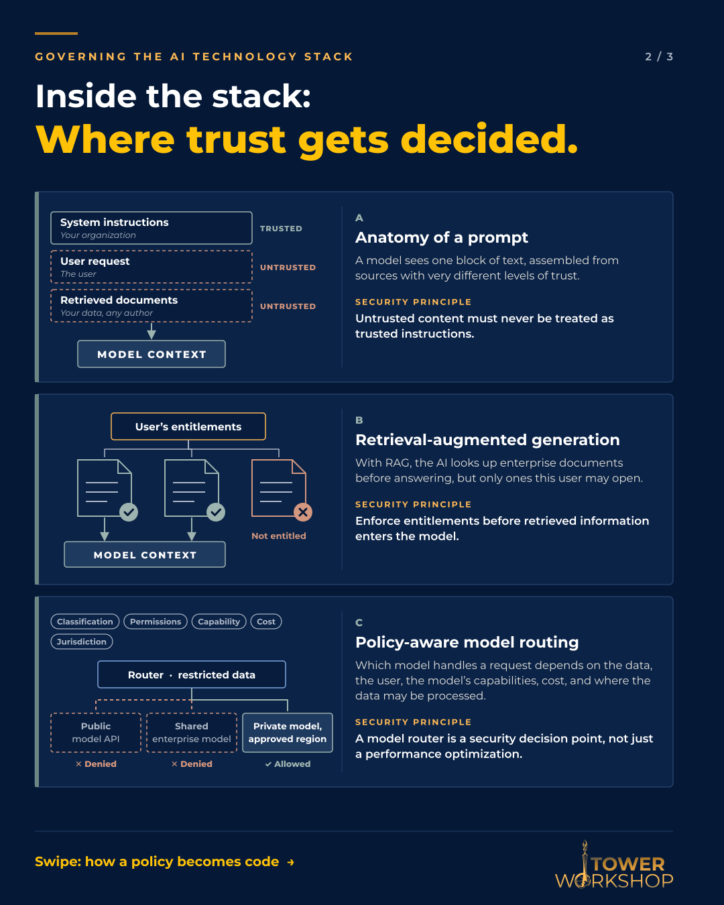
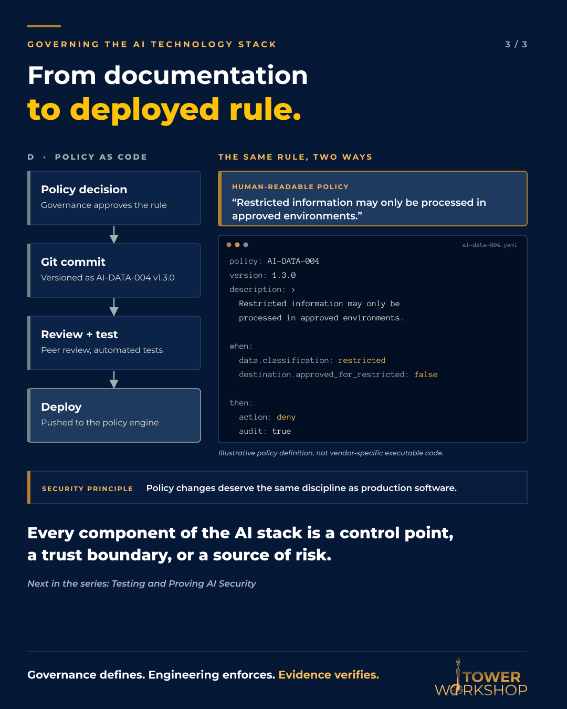

# Governing the AI Technology Stack

*Part 02 of the series [Engineering AI Governance: From Policy to Proof](README.md) · Zooms in on the Operate column of the [overview](00-engineering-ai-governance.md)*

> **A prompt goes in. An answer comes out. What happens in between?**

This infographic is a three-page carousel.






📄 [Carousel PDF](02-governing-the-ai-technology-stack.pdf) · 🖨️ [Light print PDF](02-governing-the-ai-technology-stack-light.pdf) · 🖼️ Light version: [page 1](02-governing-the-ai-technology-stack-light-p1.png), [page 2](02-governing-the-ai-technology-stack-light-p2.png), [page 3](02-governing-the-ai-technology-stack-light-p3.png) · 💬 Discussion on LinkedIn (link coming soon)

## Summary

Once a request passes the enforcement checkpoints in 01, it enters the AI application itself. A single AI transaction moves through eight steps, and governance can act at most of them. Two capabilities cut across the whole stack: **policy management**, which turns governance decisions into rules a policy engine enforces, and **data protection**, which classifies data and controls who may retrieve it and where it may go. Every component is a control point, a trust boundary, or a source of risk.

## Key takeaways

- **An AI answer is a transaction, not a single event.** Identity, inspection, context assembly, routing, inference, and output checks are all separate places where policy can act.
- **Not everything in a prompt deserves the same trust.** System instructions come from your organization; user input and retrieved documents can carry hidden instructions.
- **Entitlements must be checked before data reaches the model.** Once a document is in the model's context, it can surface in the answer.
- **Model routing is a security decision.** Choosing a model also decides where data is processed, under which terms, and in which jurisdiction.
- **Tool calls loop back.** When a model asks to take an action, that request goes back through authorization rather than being trusted automatically.
- **Governance can be engineered.** A policy written as code can be versioned, reviewed, tested, and deployed like software, and its decisions can be logged as evidence.

## How to read the visual

**Page 1: AI transactions from prompt to response.** *Governance lives in the steps you never see.* The left column follows a single request through eight steps. Tags show where **POLICY** (the policy engine) and **DATA** (data protection) act.

| Step | What happens | Where governance acts |
|------|--------------|-----------------------|
| 1. User prompt | The request arrives with the user's identity. | Identity is captured for every later decision |
| 2. API gateway | The caller is authenticated and authorized. | Policy |
| 3. Input inspection | DLP and prompt guardrails check the request. | Policy, data |
| 4. Context assembly | System instructions, the user prompt, and retrieved documents are combined. Retrieved content is treated as untrusted. | Data (entitlements) |
| 5. Model routing | A model permitted for this data is selected. | Policy, data (classification) |
| 6. LLM inference | The model generates a response or asks to use a tool. | (The model itself) |
| 7. Output inspection | The response is evaluated, then redacted or blocked if needed. | Policy, data |
| 8. Response or action | The answer is delivered, or a tool request is sent back to step 2 for authorization. | Policy |

The right column is the **control plane**: policy management (Git → CI/CD pipeline → policy engine) and data protection (classification, DLP rules, RAG entitlements). Every step writes to the audit trail.

**Page 2: three ideas behind the stack.**

- **A. Anatomy of a prompt.** A model sees one block of text assembled from sources with different levels of trust. *Security principle: untrusted content must never be treated as trusted instructions.*
- **B. Retrieval-augmented generation.** The AI retrieves enterprise documents, but only those the user is entitled to open; the rest never reach the model. *Security principle: enforce entitlements before retrieved information enters the model.*
- **C. Policy-aware model routing.** Classification, user permissions, model capability, cost, and jurisdiction determine which model may handle a request. For restricted data, a public API and a shared model are denied; a private model in an approved region is allowed. *Security principle: a model router is a security decision point, not just a performance optimization.*

**Page 3: D. Policy as code.** A governance decision becomes a Git commit, goes through review and automated tests, and is deployed to the policy engine. The same rule is shown in plain language and as an illustrative definition:

> "Restricted information may only be processed in approved environments."

```yaml
policy: AI-DATA-004
version: 1.3.0
description: >
  Restricted information may only be
  processed in approved environments.

when:
  data.classification: restricted
  destination.approved_for_restricted: false

then:
  action: deny
  audit: true
```

*Illustrative policy definition, not vendor-specific executable code.* *Security principle: policy changes deserve the same discipline as production software.*

## Why it matters

Most AI risk discussions stop at "which AI tools are allowed." The harder questions sit inside the applications: what the model is allowed to read, which instructions it obeys, where the data goes, and what happens when the model asks to act. Each of those is a design decision someone makes, deliberately or by default. Writing the rules as code turns those decisions into something that can be reviewed, tested, versioned, and proven.

Questions to ask your team:

1. In our AI applications, which content is treated as instructions, and could a retrieved document or email change the model's behavior?
2. Does our retrieval layer enforce the same permissions as the source systems, before the model sees the data?
3. Who decides which model handles sensitive data, and is that decision written down and enforced?
4. When an AI agent asks to use a tool, what authorizes that action?
5. Are our AI policies versioned and tested, or do they live only in documents?

## Key terms

| Term | Definition |
|------|------------|
| **System instructions** | The organization's standing instructions to the model, such as its role and rules. Also called a system prompt. |
| **Model context** | Everything the model sees for one request: system instructions, the user's prompt, and any retrieved content. |
| **Indirect prompt injection** | Instructions hidden in content the AI reads, such as a document, web page, or email, that try to change its behavior. |
| **RAG** (Retrieval-Augmented Generation) | A technique that retrieves relevant enterprise documents and adds them to the model's context before it answers. |
| **Entitlement** | A user's permission to access a specific piece of data. |
| **Data classification** | Labeling data by sensitivity, such as public, internal, confidential, or restricted. |
| **Model router** | A component that decides which model handles each request. |
| **Inference** | The model generating its output for a given input. |
| **Tool call** | A model's request to take an action, such as querying a database or sending a message. |
| **Policy engine** | A service that evaluates rules and returns decisions such as allow or deny. |
| **Policy as code** | Writing policy rules in machine-readable form, stored in version control, so they can be tested, reviewed, and deployed like software. |
| **CI/CD** (Continuous Integration / Continuous Delivery) | An automated pipeline that tests changes and deploys them once they pass. |

## Representative tools

> **Note:** These are examples to help readers recognize the policy-as-code category. They are not endorsements or recommendations. Tower Workshop is vendor-neutral and does not resell products. The YAML in this infographic is illustrative and is not written for any of these tools.

| Category | Examples |
|----------|----------|
| Policy engines and policy languages | Open Policy Agent (Rego), Cedar, HashiCorp Sentinel |

<!-- Tool list last reviewed 2026-11-27. Re-check names before each update. -->

## Sources and further reading

This infographic is an original synthesis drawn from practice. These resources cover the same ground in more depth:

1. [OWASP, *Top 10 for LLM Applications*, 2025.](https://genai.owasp.org/llm-top-10/)
2. [NIST, *Artificial Intelligence Risk Management Framework (AI RMF 1.0)*, NIST AI 100-1, 2023.](https://www.nist.gov/itl/ai-risk-management-framework)
3. [MITRE, *ATLAS: Adversarial Threat Landscape for Artificial-Intelligence Systems*.](https://atlas.mitre.org/)

## Related visuals

- [00 Engineering AI Governance: Overview](00-engineering-ai-governance.md): where the stack fits in the whole system.
- [01 Enforcing AI Policy](01-enforcing-ai-policy.md): the checkpoints a request passes before it reaches the stack.
- **03 Testing and Proving AI Security** (coming soon): how to show these controls actually work.

## Files

| File | Use |
|------|-----|
| `02-governing-the-ai-technology-stack-p1.png` … `-p3.png` | Pages 1–3, 1080 × 1350, for viewing on GitHub |
| `02-governing-the-ai-technology-stack-p1@2x.png` … `-p3@2x.png` | Pages 1–3, 2160 × 2700, for LinkedIn image posts and presentations |
| `02-governing-the-ai-technology-stack-p1.svg` … `-p3.svg` | Source graphics |
| `02-governing-the-ai-technology-stack.pdf` | Three-page carousel for a LinkedIn document post |
| `02-governing-the-ai-technology-stack-light-p1.png` … `-p3.png` / `.svg` | Light version for documents and slides |
| `02-governing-the-ai-technology-stack-light.pdf` | Light version for printing (vector, letter width) |
| `source/build-02.py` | Script that generates all three pages in both themes from one set of text |

To regenerate (requires Python 3 with Pillow, `rsvg-convert`, and the Montserrat and DejaVu Sans Mono fonts; set `MONTSERRAT_TTF` or `MONO_TTF` if the font files are not in the default locations):

```bash
B=02-governing-the-ai-technology-stack
python3 source/build-02.py dark  source/tower-workshop-logo-gold.png .
python3 source/build-02.py light source/tower-workshop-logo-navy.png .
for n in 1 2 3; do
  rsvg-convert -w 1080 -h 1350 $B-p$n.svg -o $B-p$n.png
  rsvg-convert -w 2160 -h 2700 $B-p$n.svg -o $B-p$n@2x.png
  rsvg-convert -w 1080 -h 1350 $B-light-p$n.svg -o $B-light-p$n.png
done
rsvg-convert -f pdf $B-p1.svg $B-p2.svg $B-p3.svg -o $B.pdf
rsvg-convert -f pdf -w 816 -h 1020 $B-light-p1.svg $B-light-p2.svg $B-light-p3.svg -o $B-light.pdf
```

## Change log

| Version | Date | Change |
|---------|------|--------|
| 1.0 | 2026-11-27 | First published |

---

*Licensed under [CC BY 4.0](../../LICENSE). Credit: Tower Workshop LLC, [github.com/TheTowerworkshop/study-visuals](https://github.com/TheTowerworkshop/study-visuals). This is a study aid, not legal, compliance, or professional advice.*
